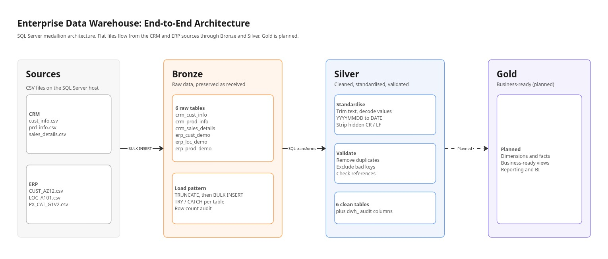
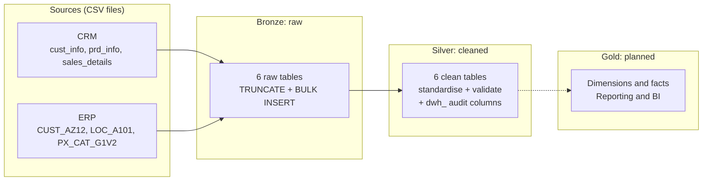
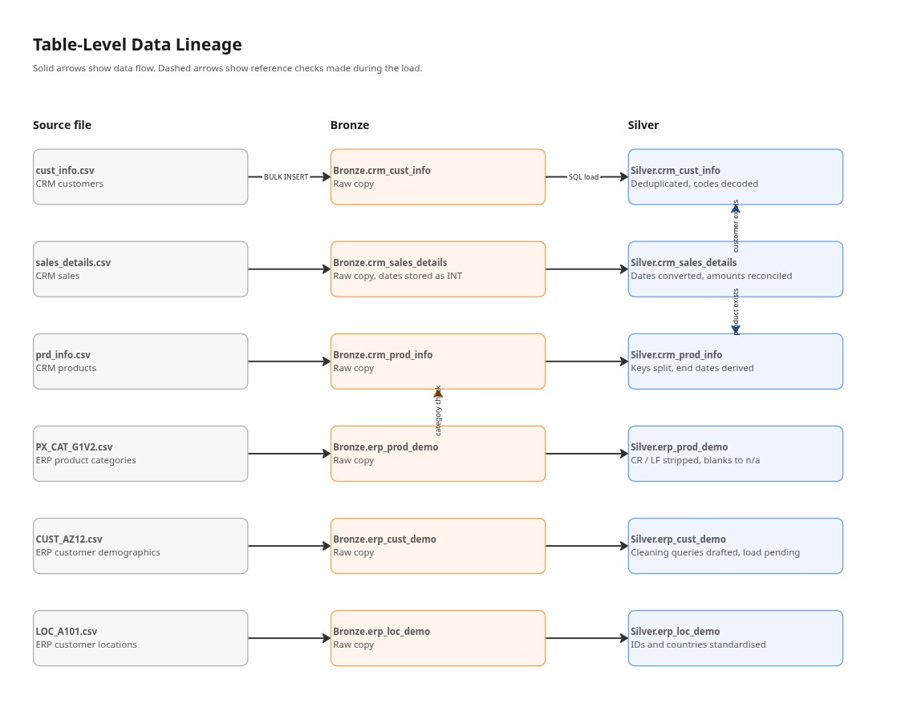
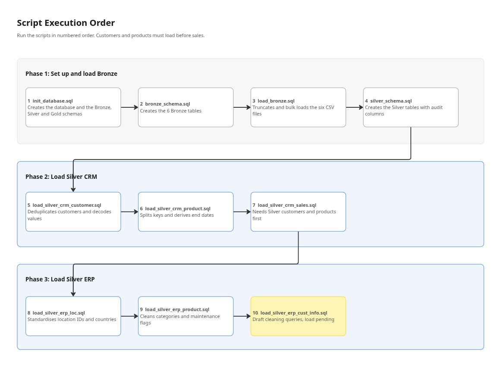

# Enterprise Data Warehouse

A SQL Server data warehouse built on the **Medallion architecture** (Bronze, Silver, Gold). It integrates customer, product and sales data from two source systems, a CRM and an ERP, into a clean and validated analytical foundation.

**Author:** Mutsala
**Platform:** SQL Server (T-SQL)
**Status:** Bronze complete, Silver in progress, Gold planned

---

## Table of Contents

1. [Project Overview](#project-overview)
2. [Architecture](#architecture)
3. [Data Sources](#data-sources)
4. [Data Lineage](#data-lineage)
5. [Repository Structure](#repository-structure)
6. [Execution Order](#execution-order)
7. [Layer Summaries](#layer-summaries)
8. [Getting Started](#getting-started)
9. [Known Limitations](#known-limitations)
10. [Roadmap](#roadmap)
11. [Documentation](#documentation)

---

## Project Overview

Source systems rarely agree with each other. Customer codes differ between the CRM and the ERP, dates arrive as integers, and text fields carry hidden line-break characters. This project solves that by moving data through three layers, each with a single, clear job.

| Layer | Purpose | State of the data |
|-------|---------|-------------------|
| **Bronze** | Preserve source data exactly as received | Raw, unvalidated |
| **Silver** | Clean, standardise and validate | Trusted, conformed |
| **Gold** | Serve analytics and reporting | Business-ready (planned) |

---

## Architecture



*Diagram 1: End-to-end architecture. [Open the editable version in Miro](https://miro.com/app/board/uXjVEVWjsCo=/).*

The same flow in text form (rendered natively by GitHub):



---

## Data Sources

| System | Source file | Bronze table | Silver table |
|--------|-------------|--------------|--------------|
| CRM | `cust_info.csv` | `Bronze.crm_cust_info` | `Silver.crm_cust_info` |
| CRM | `prd_info.csv` | `Bronze.crm_prod_info` | `Silver.crm_prod_info` |
| CRM | `sales_details.csv` | `Bronze.crm_sales_details` | `Silver.crm_sales_details` |
| ERP | `CUST_AZ12.csv` | `Bronze.erp_cust_demo` | `Silver.erp_cust_demo` |
| ERP | `LOC_A101.csv` | `Bronze.erp_loc_demo` | `Silver.erp_loc_demo` |
| ERP | `PX_CAT_G1V2.csv` | `Bronze.erp_prod_demo` | `Silver.erp_prod_demo` |

Source files are read from `/var/opt/mssql/data/source_crm/` and `/var/opt/mssql/data/source_erp/` on the SQL Server host.

---

## Data Lineage



*Diagram 2: Table-level lineage. Solid arrows show data flow. Dashed arrows show reference checks made during the Silver load.*

Three cross-table checks shape the load order:

- **Sales to customers:** a sale is loaded only if its customer exists in `Silver.crm_cust_info`.
- **Sales to products:** a sale is loaded only if its product key exists in `Silver.crm_prod_info`.
- **Products to categories:** a product is loaded only if its category exists in `Bronze.erp_prod_demo`.

---

## Repository Structure

```
Enterprise-Data-Warehouse/
├── init_database.sql                 # Database and schema creation
├── bronze_schema.sql                 # Bronze table definitions
├── load_bronze.sql                   # Bronze bulk load
├── silver_schema.sql                 # Silver table definitions
├── load_silver_crm_customer.sql      # Silver: CRM customers
├── load_silver_crm_product.sql       # Silver: CRM products
├── load_silver_crm_sales.sql         # Silver: CRM sales
├── load_silver_erp_loc.sql           # Silver: ERP locations
├── load_silver_erp_product.sql       # Silver: ERP product categories
├── load_silver_erp_cust_info.sql     # Silver: ERP customers (draft)
└── docs/
    ├── bronze_layer.md
    ├── silver_layer.md
    └── images/                       # Exported Miro diagrams
```

> Adjust this tree to match your actual folder layout if the scripts live in subfolders.

---

## Execution Order



*Diagram 3: Script execution order.*

| Step | Script | What it does |
|------|--------|--------------|
| 1 | `init_database.sql` | Creates `DataWarehouse` and the Bronze, Silver and Gold schemas |
| 2 | `bronze_schema.sql` | Creates the six Bronze tables |
| 3 | `load_bronze.sql` | Truncates and bulk loads the six CSV files |
| 4 | `silver_schema.sql` | Creates the Silver tables with audit columns |
| 5 | `load_silver_crm_customer.sql` | Deduplicates customers and decodes values |
| 6 | `load_silver_crm_product.sql` | Splits product keys and derives end dates |
| 7 | `load_silver_crm_sales.sql` | Converts dates, reconciles amounts, checks references |
| 8 | `load_silver_erp_loc.sql` | Standardises location IDs and countries |
| 9 | `load_silver_erp_product.sql` | Cleans categories and maintenance flags |
| 10 | `load_silver_erp_cust_info.sql` | Draft cleaning queries (load pending) |

**Order matters.** Step 7 must run after steps 5 and 6, because sales are validated against the Silver customer and product tables. Steps 8 and 9 create their own tables, so run them after step 4. Running `silver_schema.sql` again drops and recreates every Silver table.

---

## Layer Summaries

### Bronze: raw data

- Stores source data with no business validation.
- Reloads fully each run using `TRUNCATE` followed by `BULK INSERT`.
- Wraps each table load in `TRY / CATCH`, reports duration, and finishes with a row-count audit.
- Keeps source date values for sales as integers (`YYYYMMDD`).

Full detail: [scripts/bronze/bronze_layer.md](scripts/bronze/bronze_layer.md)

### Silver: cleaned data

Every Silver table carries audit metadata (`dwh_create_date`, `dwh_update_date`, `dwh_source`, `dwh_batch_id`) in addition to its business columns.

| Table | Key transformations |
|-------|---------------------|
| `crm_cust_info` | Removes exact duplicates, excludes conflicting and NULL IDs, decodes marital status and gender |
| `crm_prod_info` | Splits `prod_key` into category and product key, decodes product line, derives end dates, checks categories |
| `crm_sales_details` | Converts `YYYYMMDD` to `DATE`, reconciles sales, quantity and price, checks dates and references |
| `erp_cust_demo` | Strips the `NAS` prefix, nulls future birth dates, standardises gender (draft) |
| `erp_loc_demo` | Removes hyphens from IDs, strips CR / LF, standardises country names |
| `erp_prod_demo` | Strips CR / LF, converts blanks to `n/a` |

Full detail: [scripts/silver/silver_layer.md](scripts/silver/silver_layer.md)

### Gold: business-ready data

Planned. See the [Roadmap](#roadmap).

---

## Getting Started

### Prerequisites

- SQL Server 2022 or later (the scripts use `TRIM`, `DROP TABLE IF EXISTS` and `CREATE OR ALTER`)
- The six source CSV files placed in the folders listed under [Data Sources](#data-sources)
- A SQL client such as Azure Data Studio or SSMS

### Run the pipeline

1. Run the scripts in the [execution order](#execution-order).
2. After step 3, check the row-count audit at the bottom of `load_bronze.sql` output.
3. After steps 5 to 9, run the post-load validation queries included in each script.

---

## Known Limitations

These are documented openly so that nobody is surprised by them.

| Area | Limitation |
|------|------------|
| ERP customers | `load_silver_erp_cust_info.sql` contains exploratory and draft transformation queries only. It does not yet insert into `Silver.erp_cust_demo`. |
| Table definitions | `load_silver_erp_loc.sql` and `load_silver_erp_product.sql` recreate their Silver tables with a smaller set of audit columns than `silver_schema.sql` defines. |
| Batch tracking | `dwh_batch_id` is `NULL` in all loads until batch tracking is implemented. |
| Conflicting customers | Customer IDs with conflicting records are excluded from Silver, so their sales are also excluded by the reference check. |
| Gold layer | Not yet built. |

---

## Roadmap

- [ ] Complete the ERP customer load into Silver
- [ ] Align Silver table definitions across `silver_schema.sql` and the ERP load scripts
- [ ] Add batch ID tracking
- [ ] Wrap the Silver loads into stored procedures with a single orchestration script
- [ ] Build the Gold layer: dimension and fact views
- [ ] Add data quality reporting for excluded records

---

## Documentation

| Document | Contents |
|----------|----------|
| [Bronze layer](scripts/bronze/bronze_layer.md) | Purpose, tables, load flow |
| [Silver layer](scripts/silver/silver_layer.md) | Transformations and quality rules per table |
| [Miro board](https://miro.com/app/board/uXjVEVWjsCo=/) | Editable architecture diagrams |
