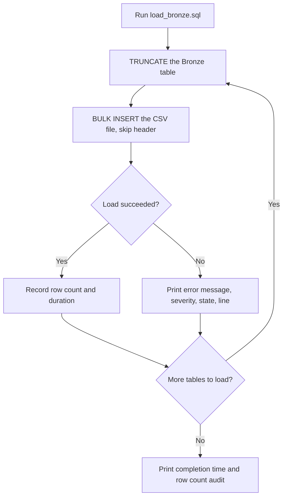
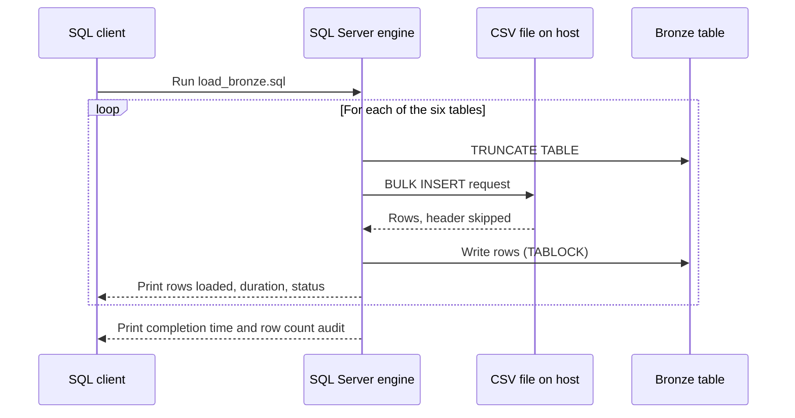

# Bronze Layer

The Bronze layer is the landing zone of the data warehouse. It holds a faithful copy of the CRM and ERP source files, with no cleaning and no business rules applied.

**Scripts:** [`bronze_schema.sql`](../bronze_schema.sql), [`load_bronze.sql`](../load_bronze.sql)
**Schema:** `Bronze`
**Load type:** Full reload (truncate and bulk insert)

---

## Table of Contents

1. [Purpose](#purpose)
2. [What Bronze Does and Does Not Do](#what-bronze-does-and-does-not-do)
3. [Table Catalogue](#table-catalogue)
4. [How the Load Works](#how-the-load-works)
5. [Load Flow](#load-flow)
6. [Request Flow](#request-flow)
7. [Error Handling](#error-handling)
8. [Operational Notes](#operational-notes)
9. [Verifying a Load](#verifying-a-load)
10. [Handoff to Silver](#handoff-to-silver)

---

## Purpose

Bronze exists so that every later layer can be rebuilt from an untouched copy of the source. If a Silver rule turns out to be wrong, the original values are still in Bronze and nothing needs to be re-extracted.

Three principles guide the layer:

- **Preserve.** Store what the source sent, as it was sent.
- **Ingest quickly.** Use bulk loading, with no row-by-row logic.
- **Defer judgement.** Leave validation and cleaning to Silver.

---

## What Bronze Does and Does Not Do

| Bronze does | Bronze does not |
|-------------|-----------------|
| Create one table per source file | Remove duplicates |
| Load each file in full on every run | Fix or standardise values |
| Skip the header row of each file | Validate keys or references |
| Report row counts, duration and errors | Convert sales dates from integers |
| Keep column names close to the source | Add audit columns |

---

## Table Catalogue

Six tables are created by `bronze_schema.sql`. Each run of that script drops and recreates them.

### CRM

**`Bronze.crm_cust_info`** loaded from `cust_info.csv`

| Column | Type |
|--------|------|
| `cust_id` | `INT` |
| `cust_key` | `NVARCHAR(50)` |
| `cust_firstname` | `NVARCHAR(50)` |
| `cust_lastname` | `NVARCHAR(50)` |
| `cust_material_status` | `NVARCHAR(50)` |
| `cust_gndr` | `NVARCHAR(50)` |
| `cust_create_date` | `DATE` |

**`Bronze.crm_prod_info`** loaded from `prd_info.csv`

| Column | Type |
|--------|------|
| `prod_id` | `INT` |
| `prod_key` | `NVARCHAR(50)` |
| `prod_name` | `NVARCHAR(50)` |
| `prod_cost` | `DECIMAL(10,2)` |
| `prod_line` | `NVARCHAR(50)` |
| `prod_start_date` | `DATE` |
| `prod_end_date` | `DATE` |

**`Bronze.crm_sales_details`** loaded from `sales_details.csv`

| Column | Type | Note |
|--------|------|------|
| `sale_ord_num` | `NVARCHAR(50)` | |
| `sale_prd_key` | `NVARCHAR(50)` | |
| `sale_cust_id` | `INT` | |
| `sale_ord_date` | `INT` | Stored as `YYYYMMDD`, for example `20101229` |
| `sale_ship_date` | `INT` | Converted to `DATE` in Silver |
| `sale_due_date` | `INT` | Converted to `DATE` in Silver |
| `sale_sales` | `DECIMAL(10,2)` | |
| `sale_quantity` | `INT` | |
| `sale_price` | `DECIMAL(10,2)` | |

### ERP

**`Bronze.erp_cust_demo`** loaded from `CUST_AZ12.csv`

| Column | Type |
|--------|------|
| `cust_cid` | `NVARCHAR(50)` |
| `cust_bdate` | `DATE` |
| `cust_gender` | `NVARCHAR(50)` |

**`Bronze.erp_loc_demo`** loaded from `LOC_A101.csv`

| Column | Type |
|--------|------|
| `loc_cid` | `NVARCHAR(50)` |
| `loc_cntry` | `NVARCHAR(50)` |

**`Bronze.erp_prod_demo`** loaded from `PX_CAT_G1V2.csv`

| Column | Type |
|--------|------|
| `prod_id` | `NVARCHAR(50)` |
| `prod_category` | `NVARCHAR(50)` |
| `prod_subcategory` | `NVARCHAR(50)` |
| `prod_maintainance` | `NVARCHAR(50)` |

> Column names are kept as they appear in the scripts, including `cust_material_status` and `prod_maintainance`, so that Silver can map them one to one.

---

## How the Load Works

`load_bronze.sql` loads the six tables in two sections, CRM first and then ERP.

| Step | Table | Source file |
|------|-------|-------------|
| 1.1 | `Bronze.crm_cust_info` | `/var/opt/mssql/data/source_crm/cust_info.csv` |
| 1.2 | `Bronze.crm_prod_info` | `/var/opt/mssql/data/source_crm/prd_info.csv` |
| 1.3 | `Bronze.crm_sales_details` | `/var/opt/mssql/data/source_crm/sales_details.csv` |
| 2.1 | `Bronze.erp_cust_demo` | `/var/opt/mssql/data/source_erp/CUST_AZ12.csv` |
| 2.2 | `Bronze.erp_loc_demo` | `/var/opt/mssql/data/source_erp/LOC_A101.csv` |
| 2.3 | `Bronze.erp_prod_demo` | `/var/opt/mssql/data/source_erp/PX_CAT_G1V2.csv` |

Every step follows the same pattern:

1. `TRUNCATE TABLE` empties the Bronze table.
2. `BULK INSERT` loads the file with these options:

| Option | Value | Meaning |
|--------|-------|---------|
| `FIRSTROW` | `2` | Skip the header line |
| `FIELDTERMINATOR` | `,` | Columns are comma separated |
| `ROWTERMINATOR` | `0x0a` | Rows end with a line feed |
| `TABLOCK` | on | Lock the table for a faster bulk load |

3. The row count and duration are captured and printed with a status.
4. After all six steps, a final query counts the rows in each Bronze table.

---

## Load Flow


*Diagram B1: what happens for each table, including the success and failure paths. [Open in Miro](https://miro.com/app/board/uXjVEVWjsCo=/).*



---

## Request Flow


*Diagram B2: who does what when a single table is loaded.*



---

## Error Handling

Each table load sits inside its own `TRY / CATCH` block. When a load fails, the script prints:

- the error message
- the severity
- the state
- the line number

The `CATCH` block does not re-throw the error, so **the run continues with the next table**. This keeps one bad file from blocking the other five, but it has two consequences:

- A failed table has already been truncated, so it is left **empty**.
- The script still prints the "completed" banner at the end. The final row count audit is the reliable way to see what actually loaded.

---

## Operational Notes

| Topic | Note |
|-------|------|
| File location | The files must exist at the paths above on the SQL Server host, and the SQL Server service account must be able to read them. |
| Re-running the schema | `bronze_schema.sql` drops and recreates every Bronze table. Run it before the first load, not between loads. |
| No transaction | Truncate and load are not wrapped in a transaction. A failure part way through leaves that table empty or partly loaded. |
| Line endings | Rows end at `0x0a`. A file saved with Windows line endings (`CRLF`) leaves a hidden carriage return at the end of its last column. The Silver ERP scripts strip CR and LF characters, which fits this behaviour. |
| Sales dates | Sales dates are `INT` because the source stores them as `YYYYMMDD` numbers. They stay that way until Silver. |
| Repeatability | The load is a full refresh, so running it twice gives the same result and never duplicates rows. |

---

## Verifying a Load

The load script ends with a row count across all six tables. To run the check on its own:

```sql
SELECT 'Bronze.crm_cust_info'     AS table_name, COUNT(*) AS rows_loaded FROM Bronze.crm_cust_info     UNION ALL
SELECT 'Bronze.crm_prod_info'     AS table_name, COUNT(*) AS rows_loaded FROM Bronze.crm_prod_info     UNION ALL
SELECT 'Bronze.crm_sales_details' AS table_name, COUNT(*) AS rows_loaded FROM Bronze.crm_sales_details UNION ALL
SELECT 'Bronze.erp_cust_demo'     AS table_name, COUNT(*) AS rows_loaded FROM Bronze.erp_cust_demo     UNION ALL
SELECT 'Bronze.erp_loc_demo'      AS table_name, COUNT(*) AS rows_loaded FROM Bronze.erp_loc_demo      UNION ALL
SELECT 'Bronze.erp_prod_demo'     AS table_name, COUNT(*) AS rows_loaded FROM Bronze.erp_prod_demo;
```

**What to look for**

| Result | Meaning |
|--------|---------|
| A table shows `0` rows | Its load failed or the file was empty. Check the error output for that step. |
| A count is lower than the file's line count minus one | Rows were rejected. Review the file format and the error output. |
| All counts match the source files | Bronze is ready for Silver. |

---

## Handoff to Silver

Bronze deliberately leaves problems in place so that Silver can find and handle them. Examples visible in the Silver scripts:

| Issue left in Bronze | Handled in Silver by |
|----------------------|----------------------|
| Duplicate customer records | `load_silver_crm_customer.sql` |
| Combined category and product key in `prod_key` | `load_silver_crm_product.sql` |
| Sales dates stored as integers | `load_silver_crm_sales.sql` |
| `NAS` prefix on ERP customer IDs | `load_silver_erp_cust_info.sql` |
| Hyphens and hidden CR / LF characters | `load_silver_erp_loc.sql`, `load_silver_erp_product.sql` |

Continue with the [Silver layer documentation](silver_layer.md).