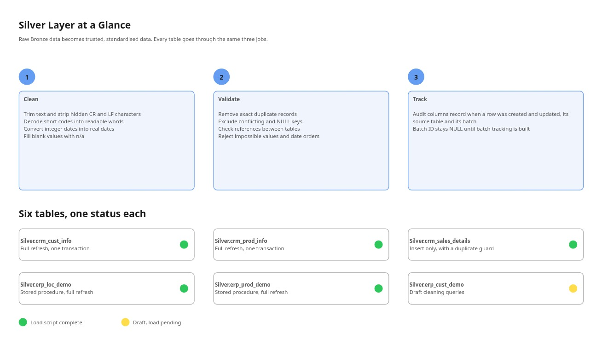
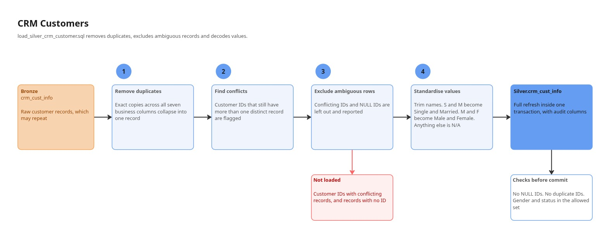
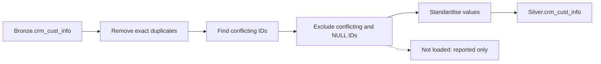
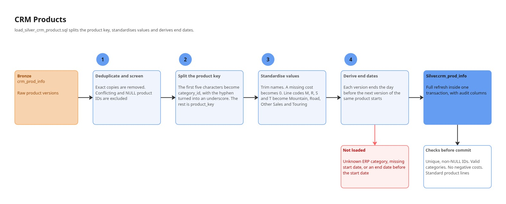
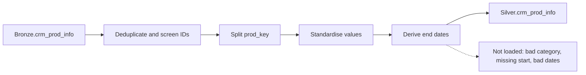
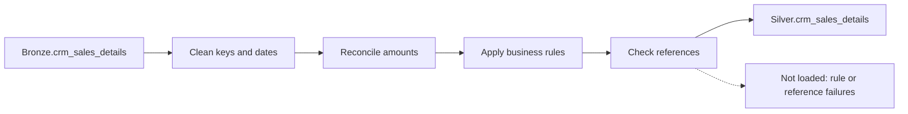
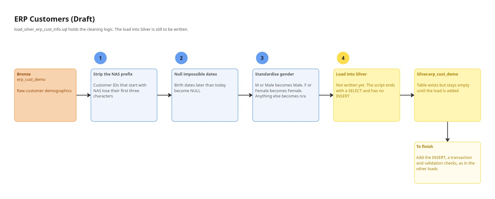
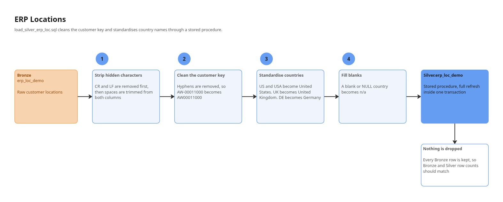
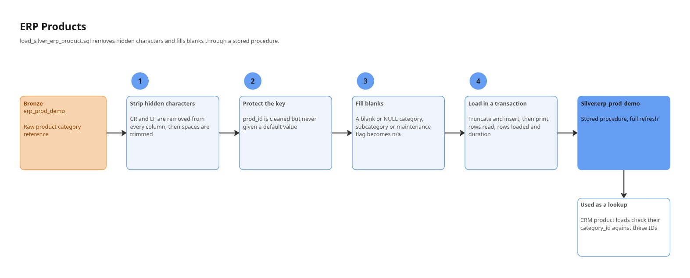

# Silver Layer

The Silver layer turns raw Bronze data into trusted, standardised data. Every record is cleaned, checked and tagged with audit information before it is allowed through.

**Scripts:** [`silver_schema.sql`](../silver_schema.sql) and six load scripts
**Schema:** `Silver`
**Source:** the [Bronze layer](bronze_layer.md)

---

## Table of Contents

1. [Purpose](#purpose)
2. [Silver at a Glance](#silver-at-a-glance)
3. [Audit Columns](#audit-columns)
4. [Load Order](#load-order)
5. [CRM Customers](#crm-customers)
6. [CRM Products](#crm-products)
7. [CRM Sales](#crm-sales)
8. [ERP Customers (Draft)](#erp-customers-draft)
9. [ERP Locations](#erp-locations)
10. [ERP Products](#erp-products)
11. [Data Quality Policy](#data-quality-policy)
12. [Known Issues](#known-issues)

---

## Purpose

Bronze keeps data exactly as the source sent it. Silver answers the question: *can we trust this?*

| Job | What it means |
|-----|---------------|
| **Clean** | Trim text, strip hidden characters, decode short codes, convert integer dates |
| **Validate** | Remove duplicates, exclude ambiguous keys, check references between tables |
| **Track** | Stamp every row with audit columns |

---

## Silver at a Glance



*Diagram S1: the three jobs of Silver and the status of each table. [Open in Miro](https://miro.com/app/board/uXjVEVWjsCo=/).*

| Silver table | Source | Load style | Status |
|--------------|--------|------------|--------|
| `Silver.crm_cust_info` | `Bronze.crm_cust_info` | Full refresh, one transaction | See [Known Issues](#known-issues) |
| `Silver.crm_prod_info` | `Bronze.crm_prod_info` | Full refresh, one transaction | Complete |
| `Silver.crm_sales_details` | `Bronze.crm_sales_details` | Insert only, duplicate guard | Complete |
| `Silver.erp_loc_demo` | `Bronze.erp_loc_demo` | Stored procedure, full refresh | Complete |
| `Silver.erp_prod_demo` | `Bronze.erp_prod_demo` | Stored procedure, full refresh | Complete |
| `Silver.erp_cust_demo` | `Bronze.erp_cust_demo` | None yet | Draft |

---

## Audit Columns

Tables defined in `silver_schema.sql` carry four audit columns in addition to their business columns.

| Column | Type | Purpose |
|--------|------|---------|
| `dwh_create_date` | `DATETIME2(3)` | When the row was first loaded (UTC) |
| `dwh_update_date` | `DATETIME2(3)` | When the row was last changed (UTC) |
| `dwh_source` | `NVARCHAR(50)` | The Bronze table the row came from |
| `dwh_batch_id` | `BIGINT` | Reserved for batch tracking. Currently `NULL` |

`Silver.erp_loc_demo` and `Silver.erp_prod_demo` are recreated by their own load scripts with a single `dwh_create_date` column.

---

## Load Order

Order matters because sales are checked against the Silver customer and product tables.

1. `load_silver_crm_customer.sql`
2. `load_silver_crm_product.sql`
3. `load_silver_crm_sales.sql` (after steps 1 and 2)
4. `load_silver_erp_loc.sql`
5. `load_silver_erp_product.sql`
6. `load_silver_erp_cust_info.sql` (draft)

Run `silver_schema.sql` first. It drops and recreates the Silver tables, so do not run it again between loads.

---

## CRM Customers

**Script:** `load_silver_crm_customer.sql`



*Diagram S2: CRM customer transformation.*



### Transformations

| Column | Bronze value | Silver value |
|--------|--------------|--------------|
| `cust_firstname`, `cust_lastname` | Padded or empty text | Trimmed. Empty becomes `NULL` |
| `cust_material_status` | `S` | `Single` |
| | `M` | `Married` |
| | anything else | `N/A` |
| `cust_gndr` | `M` | `Male` |
| | `F` | `Female` |
| | anything else | `N/A` |

### Rules

- **Exact duplicates** (identical across all seven business columns) collapse into one record.
- **Conflicting IDs** (the same `cust_id` with different details) are flagged and reported, not loaded.
- **NULL IDs** are reported, not loaded.
- The load is `TRUNCATE` plus `INSERT` inside one transaction.

### Checks before commit

The load rolls back if Silver contains a NULL ID, a duplicate ID, or a gender or marital status outside the allowed values.

---

## CRM Products

**Script:** `load_silver_crm_product.sql`



*Diagram S3: CRM product transformation.*



### Transformations

| Silver column | Derived from | Rule |
|---------------|--------------|------|
| `category_id` | `prod_key` | First five characters, hyphen replaced by underscore |
| `product_key` | `prod_key` | Characters from position 7 onward, trimmed |
| `product_name` | `prod_name` | Trimmed. Empty becomes `NULL` |
| `product_cost` | `prod_cost` | `NULL` becomes `0` |
| `product_line` | `prod_line` | `M` Mountain, `R` Road, `S` Other Sales, `T` Touring, else `N/A` |
| `product_start_date` | `prod_start_date` | Converted to `DATE` |
| `product_end_date` | next version's start | The day before the next version of the same `product_key` starts. `NULL` for the latest version |

The source `prod_end_date` is read but not used. End dates are always derived.

### Rules

- Exact duplicates are removed. Conflicting and NULL product IDs are excluded.
- A product loads only if its `category_id` exists in `Bronze.erp_prod_demo`, it has a start date, and its end date is not before its start date.
- The table enforces a primary key on `prod_id`, a non-negative cost, and a valid date range.

### Checks before commit

The load rolls back if Silver contains NULL or duplicate IDs, an unknown category, a negative cost, a missing name, a missing start date, an invalid date range, or a non-standard product line.

> A missing product name is not filtered out. It causes the final check to fail and the whole load to roll back.

---

## CRM Sales

**Script:** `load_silver_crm_sales.sql`


*Diagram S4: CRM sales transformation.*



### Transformations

| Column | Rule |
|--------|------|
| `sale_ord_num`, `sale_prd_key` | Trimmed. Empty becomes `NULL` |
| `sale_ord_date`, `sale_ship_date`, `sale_due_date` | An eight-digit `YYYYMMDD` number becomes a `DATE`. Anything else becomes `NULL` |
| `sale_sales` | Expected sales is `quantity x absolute price`. If sales is missing, not positive, or different from expected, the expected value is used |
| `sale_price` | If missing or not positive, it becomes `sales / quantity`. Rounded to two decimals |

### Rules for a row to load

| Rule | Detail |
|------|--------|
| Keys present | Order number, product key and customer ID must not be `NULL` |
| Positive values | Quantity, sales and price must all be above zero |
| Date order | Order date must not be after ship date or due date. Checked only when an order date exists |
| Product exists | `sale_prd_key` must match a `product_key` in `Silver.crm_prod_info` |
| Customer exists | `sale_cust_id` must match a `cust_id` in `Silver.crm_cust_info` |
| Not loaded before | The order number and product key pair must not already be in Silver |

### Notes

- This load **inserts only**. It does not truncate, so changes to Bronze do not update rows already in Silver.
- The duplicate guard compares against rows already in Silver. Duplicates within a single run are not caught.
- Rejected rows are dropped silently. The script reports only the number of rows inserted.

---

## ERP Customers (Draft)

**Script:** `load_silver_erp_cust_info.sql`



*Diagram S5: ERP customer transformation, as drafted.*

The script currently holds exploratory and draft queries. It does not insert into `Silver.erp_cust_demo`, so that table stays empty.

### Drafted transformations

| Column | Rule |
|--------|------|
| `cust_cid` (output name `cust_id`) | If the value starts with `NAS`, the first three characters are removed |
| `cust_bdate` | Birth dates later than today become `NULL` |
| `cust_gender` | `M` or `Male` becomes `Male`. `F` or `Female` becomes `Female`. Anything else becomes `n/a` |

### To finish

- Add an `INSERT` into `Silver.erp_cust_demo`, mapping the output `cust_id` to the target column `cust_cid`.
- Wrap the load in a transaction and add validation checks, as the other loads do.
- Remove the duplicated final query and the exploratory `SELECT` statements.

---

## ERP Locations

**Script:** `load_silver_erp_loc.sql` (creates the procedure `Silver.load_erp_loc_demo` and runs it)



*Diagram S6: ERP location transformation.*


### Transformations

| Column | Rule |
|--------|------|
| `loc_cid` | CR and LF removed, trimmed, then hyphens removed: `AW-00011000` becomes `AW00011000` |
| `loc_cntry` | CR and LF removed, then trimmed |
| | `US`, `USA`, `United States` become `United States` |
| | `UK`, `United Kingdom` become `United Kingdom` |
| | `DE`, `Germany` become `Germany` |
| | Blank or `NULL` becomes `n/a` |
| | Any other value is kept as cleaned |

### Notes

- Every Bronze row is kept, so Bronze and Silver row counts should match.
- The procedure prints rows read, rows loaded and duration.
- Both columns are `NOT NULL` in Silver. A `NULL` key would make the insert fail and roll back.

---

## ERP Products

**Script:** `load_silver_erp_product.sql` (creates the procedure `Silver.load_erp_prod_demo` and runs it)



*Diagram S7: ERP product transformation.*


### Transformations

| Column | Rule |
|--------|------|
| `prod_id` | CR and LF removed and trimmed. Never given a default value |
| `prod_category`, `prod_subcategory`, `prod_maintainance` | CR and LF removed and trimmed. Blank or `NULL` becomes `n/a` |

### Notes

- This table is the category reference for CRM products: `category_id` values from `Silver.crm_prod_info` should match `prod_id` here.
- The script includes post-load queries that check for hidden characters, duplicate IDs, unmatched categories and row counts.

---

## Data Quality Policy

Silver follows one consistent policy. Where the data is unclear, it is left out and reported rather than guessed.

| Situation | What Silver does |
|-----------|------------------|
| Exact duplicate rows | Keep one copy |
| Same key, different details | Exclude the key and report it (customers, products) |
| `NULL` key | Exclude and report (customers, products) |
| Unknown value or code | Replace with `N/A` or `n/a` |
| Impossible value (future birth date, invalid date) | Replace with `NULL` |
| Row breaks a business rule (sales) | Exclude |
| Reference not found | Exclude (products and sales) |
| Final check fails | Roll back the whole load |

---

## Known Issues

These are documented openly so that they can be fixed.

### 1. The customer load inserts no rows

In `load_silver_crm_customer.sql`, the working table `#CustomerQuality` is built with `HAVING COUNT(*) > 1`, so it contains **only conflicting IDs**. The insert then joins to that table and keeps rows where `distinct_record_count = 1`. No row can satisfy both conditions, so `Silver.crm_cust_info` loads **zero rows**.

The validation checks still pass on an empty table. The effect then spreads: with no Silver customers, the reference check in the sales load rejects every sale.

**Fix:** remove the `HAVING COUNT(*) > 1` line from the `#CustomerQuality` query so that it counts every customer ID. The conflict report, the insert filter and the summary all already expect that.

```sql
SELECT
    cust_id,
    COUNT(*) AS distinct_record_count
INTO #CustomerQuality
FROM #DistinctCustomers
WHERE cust_id IS NOT NULL
GROUP BY cust_id;          -- HAVING removed
```

After the fix, re-run the customer and sales loads and confirm both tables contain rows.

### 2. Other known points

| Area | Issue |
|------|-------|
| ERP customers | No load into Silver yet |
| Table definitions | The two ERP stored-procedure scripts recreate their tables with fewer audit columns than `silver_schema.sql` |
| Batch tracking | `dwh_batch_id` is always `NULL` |
| Sales | Rejected rows are not reported, and duplicates within one run are not caught |
| Gender matching | The ERP customer draft compares upper-cased text to `Female`. This works on a case-insensitive database collation but not on a case-sensitive one |